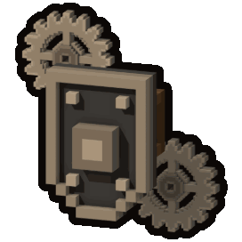

## Welcome to Hearthmakers!

---

**Thanks for stopping by our portal!**
Hearthmakers is a small personal project we put together as a tribute to one of our favourite games of recent years, **Stonehearth**. The theme follows the same line: a voxel world and building towns and colonies. But we've brought in our own style of play and many mechanics we love from other genres and games.

**Main features:**

- **Build your own world!** *Called a "Realm", every player can have their own.*
- **Control a Pioneer, you in the game!** *You have an avatar that represents you!*
- **Visit public "Realms" and play with friends!** *The game is all about being social. It's better with friends!*
- **RPG combat and progression!** *RPG elements for your characters (pioneers and colonists).*
- **Host your own server!** *Have your own server to play with your friends.*

> We believe a home begins with a campfire and a few friends gathered around it...
---

---
## In active development!
We're actively developing the project, and we invite everyone interested to join us on this journey. No project is complete without a good community, and we'd love to build our little world together with you!
