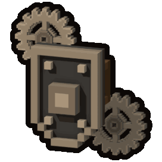

## Boas-vindas à Hearthmakers!

---

**Obrigado por visitar nosso portal!**
Hearthmakers é um pequeno projeto pessoal que montamos em homenagem a um dos nossos jogos favoritos dos últimos anos, **Stonehearth**. O tema segue a mesma linha: um mundo de voxels e construção de cidades e colônias. Porém, implementamos nosso próprio estilo de jogo e diversas mecânicas de que gostamos em outros gêneros e jogos.

**Recursos principais:**

- **Monte seu próprio mundo!** *Chamado de "Realm", cada jogador pode ter o seu.*
- **Controle um Pioneiro, você no jogo!** *Você tem um avatar que te representa!*
- **Visite "Realms" públicos e jogue com amigos!** *O foco do jogo é o social. É melhor com amigos!*
- **Combate e progressão de RPG!** *Aspectos de RPG para os personagens (pioneiros e colonos).*
- **Hospede seu próprio servidor!** *Tenha seu próprio servidor para jogar com os amigos.*

> Acreditamos que um lar começa com uma fogueira e alguns amigos em volta dela...
---

---
## Em desenvolvimento ativo!
Estamos desenvolvendo o projeto ativamente e convidamos todos os interessados a se juntarem a nós nessa jornada. Nenhum projeto fica completo sem uma boa comunidade, e queremos contar com vocês para construir o nosso pequeno mundo!
